# Drawing Templates

## Setting up the Drawing Template

Download the templates provided. Create a folder on your desktop or somewhere you know you won’t end up accidentally deleting it from.

Now open an arbitrary SolidWorks file. Within this file navigate to the **options button** up the top as shown in the image below.

Once you select this, scroll down in the window to "**File Locations**".

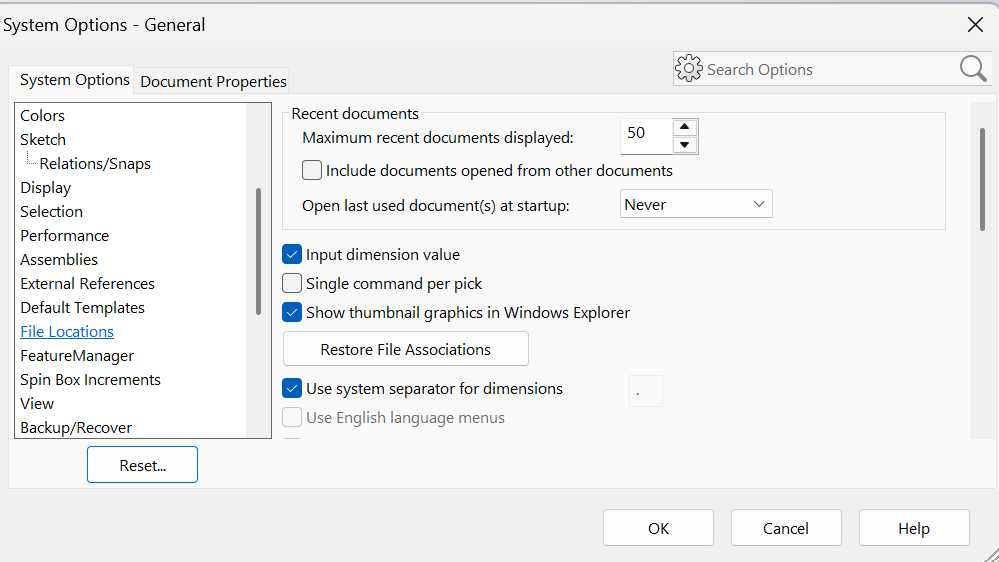

Then, scroll down in "*Show Folders for:*" until you find "**Sheet Formats**" and select it.

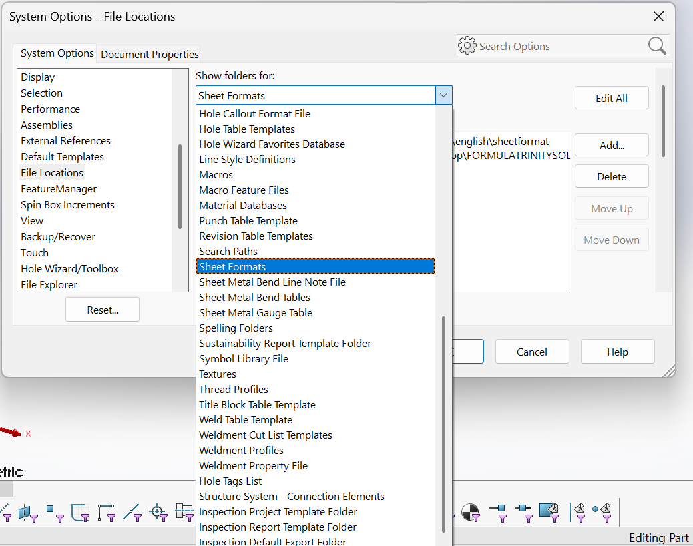

After selecting this, you will see the path where SolidWorks currently finds its templates. Select "**Add**".

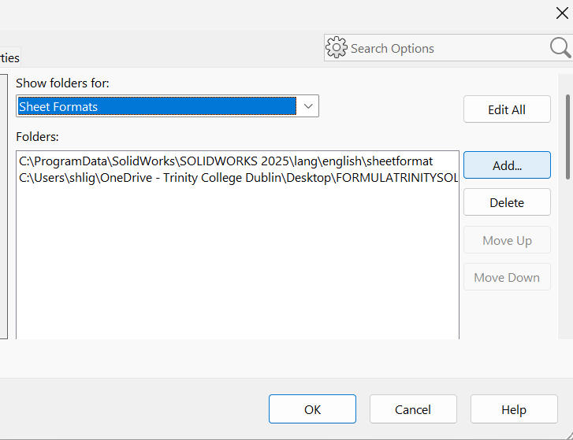

Once you have selected this, you file explorer should open. Go to the folder you initially created and select it. It may say "*No items match your search.*", this is fine. Select the blue outlined "**Select Folder**" icon. This path has now been added.

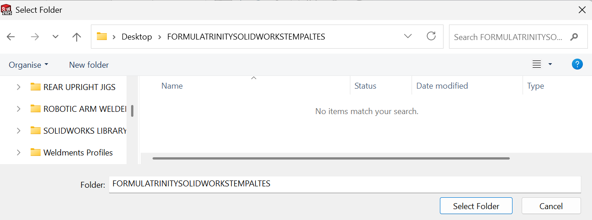

The next step is to select the "**Default Templates**" option within that same SolidWorks menu. This will allow you to make the Formual Trinity template the default option.

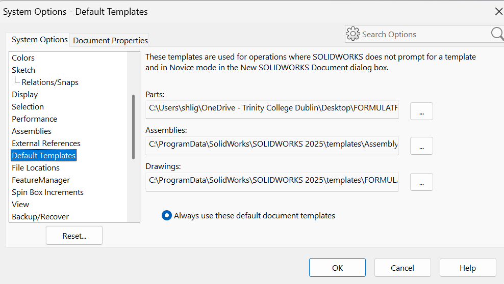

Please follow the next steps for both the "*Parts:*" **AND** "*Drawings:*" dropdowns.

Select the dots on "*Default Templates*".

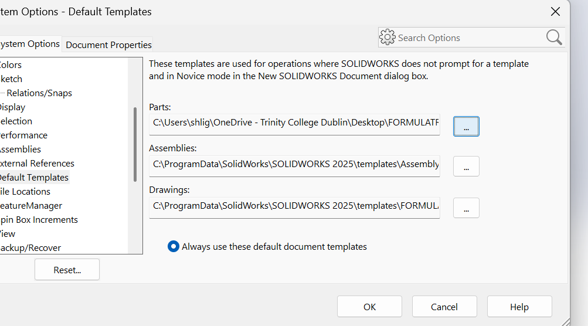

On the top, navigate to "*FORMULATRINITYSOLIDOWORKSTEMPLATES*".

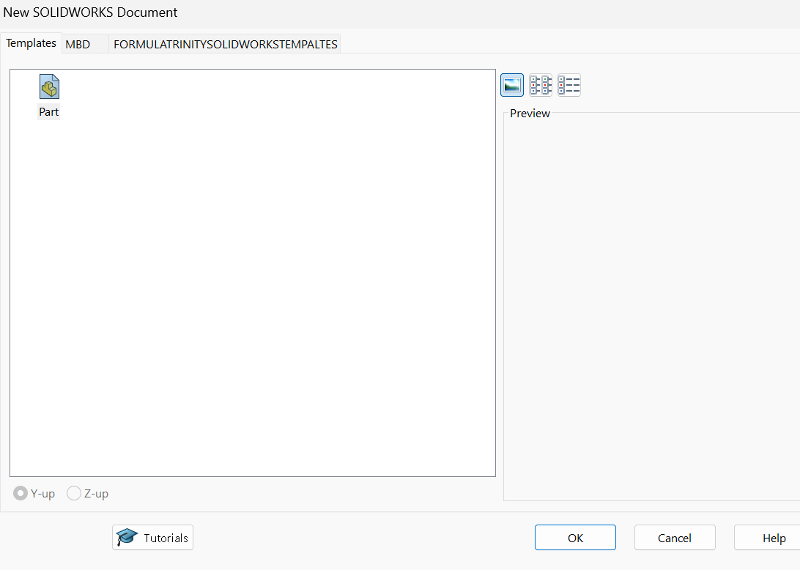

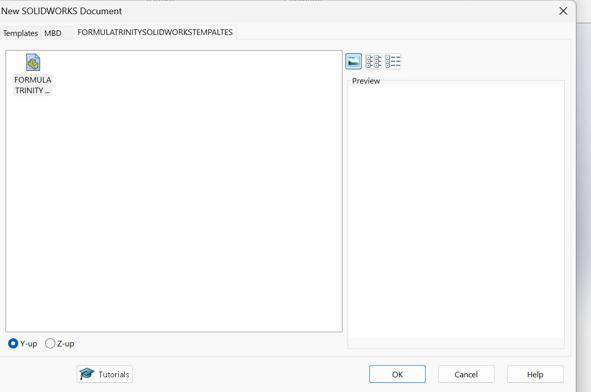

This now makes the Formula Trinity part template the default template to use.
This means that it will automatically have the pre-loaded properties sections that you are required to enter such that it will link to the Formula Trinity Drawing template.

---

## Using the Drawing Template

Once you have completed a part in SolidWorks and wish to create a drawing of this part you will select to "**File**" -> "**Make Drawing from Part**".

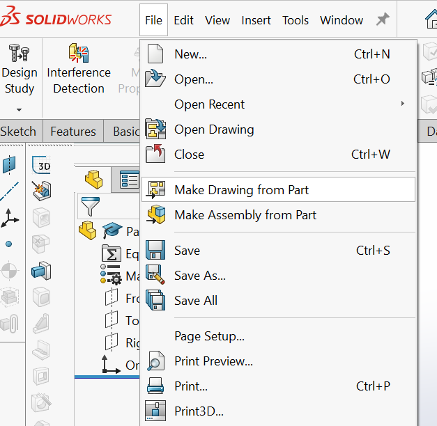

This should open up the Formula Trinity Template, it should appear as shown below:

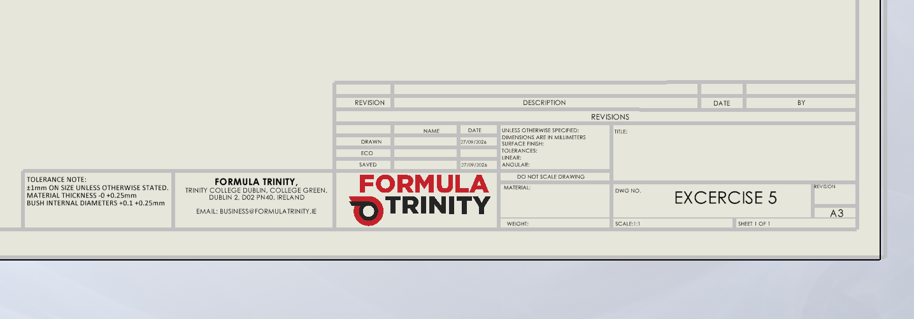

---

### Using the Properties of a Part in SolidWorks

SolidWorks has an inbuilt properties section which allows you to assign details of a part to it.
Once you have designed a part you should select the properties section, as show by the red arrow below.

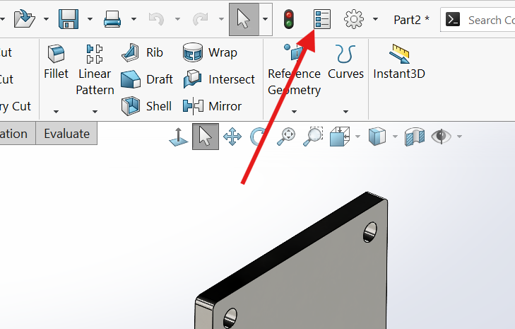

This will bring up the menu shown below.

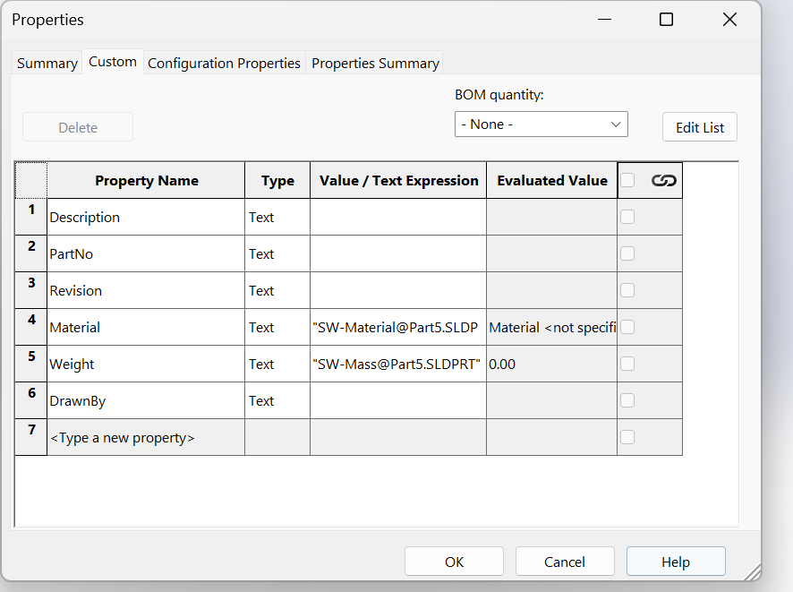

This menu allows you to edit the following categories:

| Properties  | What It Means            |
|-------------|--------------------------|
| Description | What is the part?        |
| PartNo      | FT naming convention     |
| Revision    | A, B, C, ...             |
| Material    | SW material (pre-loaded) |
| Weight      | SW mass (pre-loaded)     |
| Drawn By    | Name                     |

Note that "*PartNo*" isn't used in the actual template, I'd recommend just using the same naming convention as the part in the SharePoint just in case it becomes relevant in the future.

---

### Making BOM Template Default

To make the Formula Trinity BOM standardised on drawings, you should find the file locations section and click the dropdown as shown below.

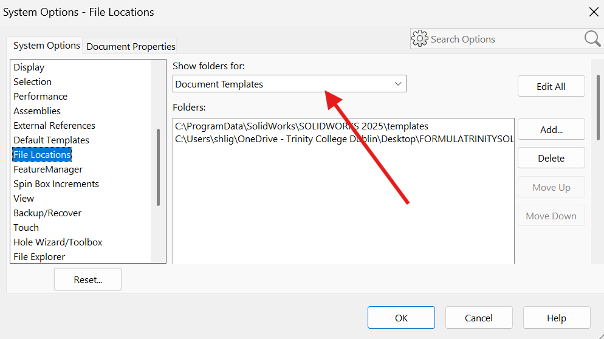

Scroll down to "**BOM Templates**" and click on it.

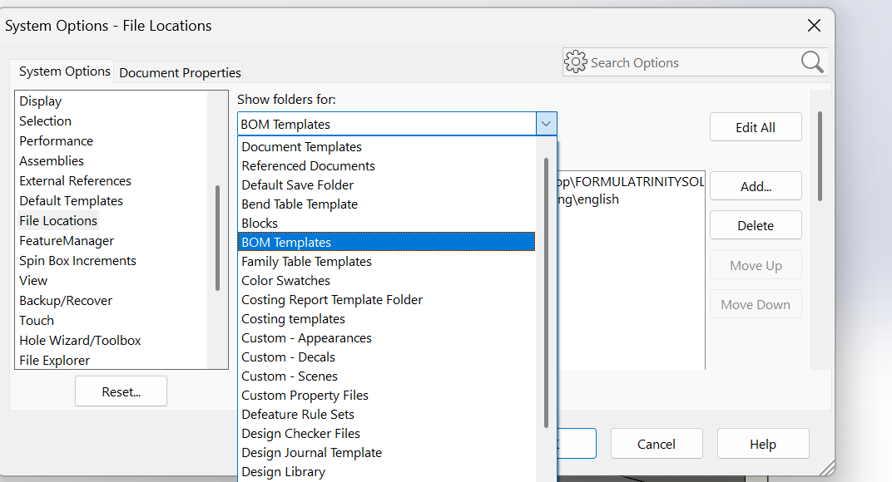

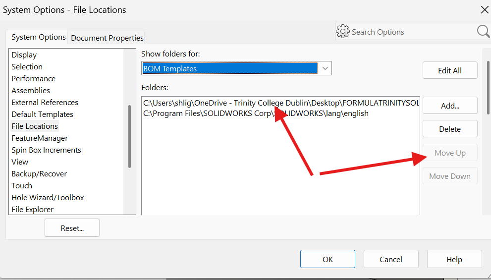
