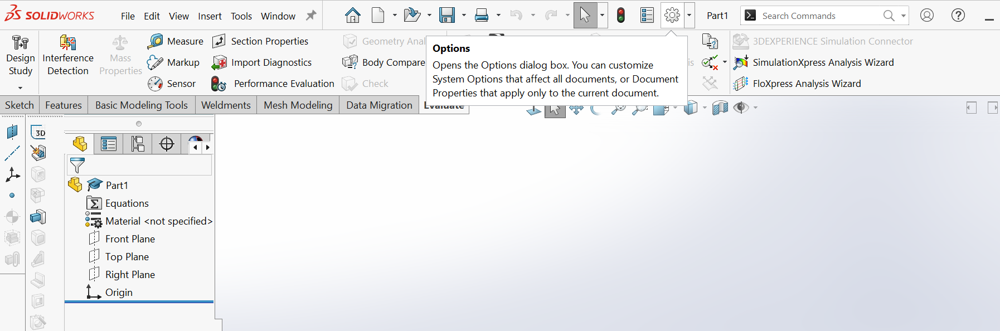

# Drawing Templates

## Saving the Templates

Download the templates provided. Create a folder on your desktop or somewhere you know you won’t end up accidentally deleting it from.
Now open an arbitrary SolidWorks file. Within this file navigate to the options button up the top as shown in the image below.

