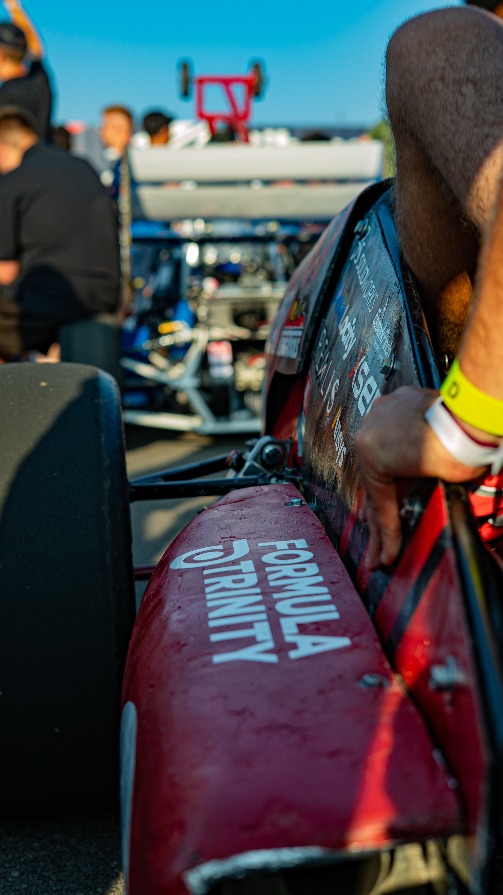

# Sidepods

The sidepods were designed to house the radiator and the exhaust for FTX7. 3D-printed moulds were used, with wet layups of 5 layers of fiber glass with epoxy and then polyester resin. This was the only final aero component of FTX7 which was manufactured in-house, with the best moulds and the the best dimensional accuracy relative to CAD. In spite of this there were several difficulties.

## Design
The sidepods were designed to house the radiator and muffler, allowing for sufficient air-flow to the radiator. In addition to this there were dimensional constraints regarding the FSUK rules on how close parts can be to tyres.

The resulting design had a relatively small inlet and outlet, and was quite narrow in it's design, at least compared to other teams.

## Mould Making
The moulds for the sidepods were female, 3D-printed moulds, neither of which had been done before for aero. The benefit of doing 3D-printed moulds is that you can have a much higher dimensional accuracy compared to manual mould-making methods, and the benefit of doing female moulds is that you can control your surface finish much better compared to male moulds.

They were made by offsetting the sidepod design in CAD, and splitting that model into sections. There ended up being 42 sections to print, which can be reduced in future designs with minimal effort. These parts were printed (in PLA and PETG), numbered, and plastic welded/soldered together to create a final mould. 

## Manufacturing and Mounting
Once the mould-making was completed a wet layup was performed, one layer of release film and 5 layers of fiberglass being applied. The release film should be reviewed for future use as it has negative effects on the surface finish.

This layup worked for the first sidepod, but the epoxy never properly set for the second sidepod, resulting in a flaccid sidepod. Additionally the design for the second sidepod did not account for the tubing of the radiator, so the second sidepod was done using the existing mould as a male mould. Even after this it did not properly account for the tubing so a small section had to be cut out to make room for the tube.

As an aside, this second layup required polyester resin to be used, which worked well and can definitely be used in the future.

The sidepods did not properly integrate with the bodywork, and the lack mounting strategy resulted in ambiguity about where to put each sidepod and how to ensure symmetry. This was done by eye, and zip-ties were used to attach the sidepods. Overall, the mounting strategy for the sidepods will have a completer overhaul for this year.

