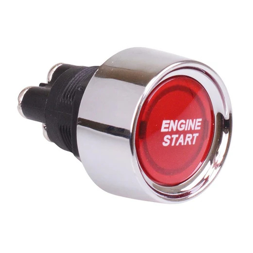

# Starter Switch

{ width="300" }

[Starter Push Button Switch](https://www.switchelectronics.co.uk/products/red-off-on-illuminated-engine-starter-push-switch-spst-50a-12v-sci-a2-23b) 

## Why do we need it?

The starter switch allows the driver to start the engine. It sends a low-current electrical signal to the starter solenoid, which then connects the battery to the starter motor.

Using a starter solenoid means that the high starter-motor current does not have to pass through the dashboard switch.

## FTX7

For FTX7, actuating the starter switch energises the [starter solenoid](../engine/starter-solenoid.md) coil. The solenoid's main contacts then close and supply battery current to the starter motor.

When the driver releases the switch, the solenoid coil is de-energised, its main contacts open and the starter motor is disconnected.

It is fed from the 12 V supply after the LVMS and connects to large pin of the starter solenoid, with the other large contact going to the starter, the smaller contacts are the signal wires for actuating the solenoid. one is connected to the starter switch and the other contact is grounded, when the start switch is pressed the power going through the solenoid closes the main contacts and allows current to flow.. The design report says that a 4 pin heavy duty starter solenoid was chosen as it is able to handle the current that the starter pulls.

The switch used is a momentary push button, meaning it only makes contact while it is held down.