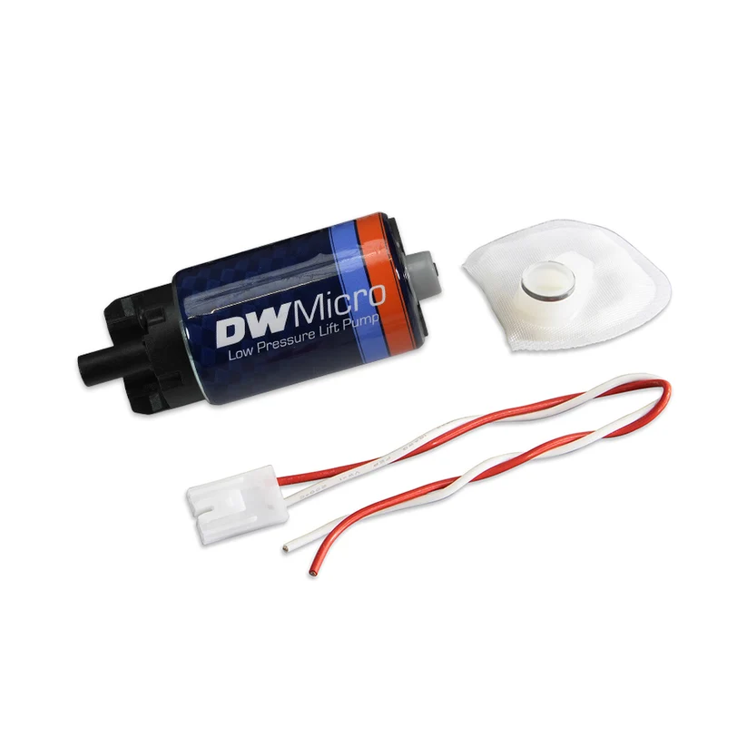

# Fuel Pump

[DWMicro Low Pressure Lift Pump Technical Data Sheet](./images/9-110_DWMicro_Low_Pressure_Lift_Pump_Tech_Sheet.pdf)

## Why do we need it

A fuel pump is an electronic pump which builds pressure inside the fuel lines and delivers fuel to the injectors. typically fuel pumps are speced using flow rate and pressure since injectors require very specific operating pressures. 

for a CBR600rr 2003-4 the injectors require a constant 3.5 Bars of pressure which origincally is deliverd using an internal regulator within the fuel tank. The regulator is a series regulator which means that the fuel pumpp is connected to the fuel injectors and also a regulator within the fuel tank, once the fuel pump exceeds the pressure inside the tank the regulator opens and releases the excess pressure and fuel into the fuel tank leaving the main rail to the injectors at a constant 3.5 Bar or 50 PSI.

The necessary specifications needed for the fuel pump can be taken from the original Honda service manual for the CBR600rr 2003-4