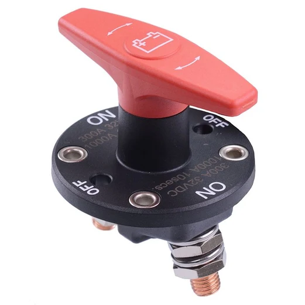

# Low Voltage Master Switch

{width="400"}

> IP67 Rated  
> **Continuous Rating:** 300A 32VDC  
> **Cranking Rating:** 1000A 10 Seconds  
> **Termination:** M10 Nuts  
> Removable Actuator  

## Why do we need it

The **Low Voltage Master Switch** (LVMS) is the master switch for powering the car, it acts as an isolator switch cutting all power from the battery to every other component on the car.

It is a rotary style switch with a removable handle.