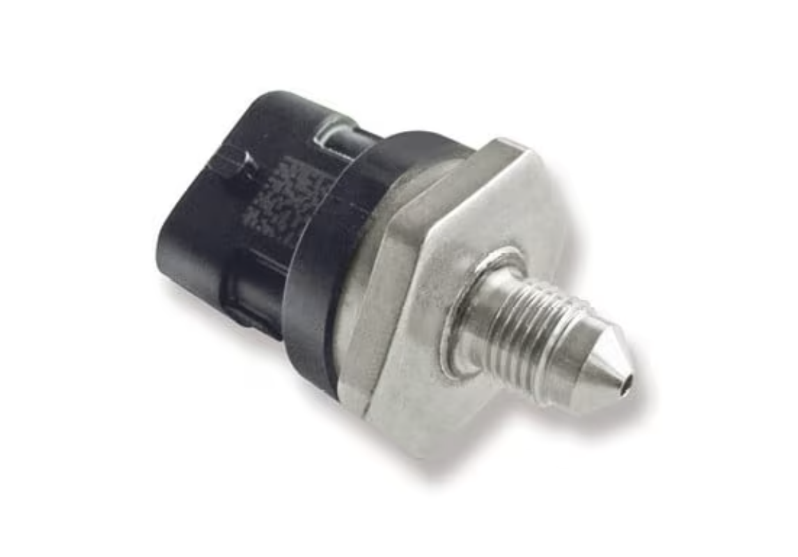

# Brake Pressure Sensor

*Figure 1: Bosch Motorsport PSS-260 Brake Pressure Sensor*

>Part number: 0261545188  
>Pressure range: 0 – 260 bar absolute  
>Response time: 2ms  
>Supply Voltage: 4.75 - 5.25V  
>Output at 0 bar: 0.5V  
>Output at 260 bar: 4.5V  
>Sensitivity: 15.38 mV/bar  
>Pinout: 1 = GND, 2 = Signal, 3 = 5V supply  
>Thread: M10x1  
>Seat: 45° cone  

A brake fluid pressure sensor senses the brake fluid pressure in a hydraulic braking system. The sensor is a type of pressure switch that shows and alerts a fault in the braking system.

The Bosch Motorsport PSS-260 measures brake hydraulic pressure from 0 to 260 bar with a 2 ms response time — fast enough to capture individual ABS (anti-lock braking system) modulation events and brake pressure traces during a lap. It connects directly to any ECU or data logger analog input with a 5 V supply.

The ratiometric 5 V output characteristic is 0.5 V = 0 bar, 4.5 V = 260 bar; sensitivity 15.38 mV/bar.