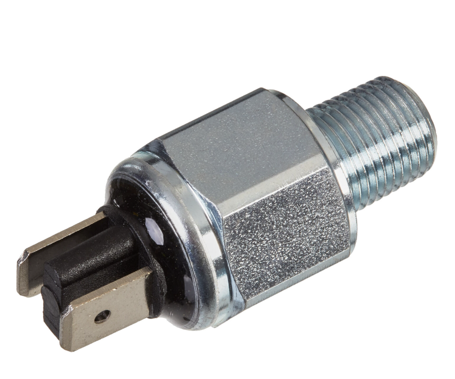

# Brake Light Switch

*Figure 1: Brake Light Switch (Not the exact model)*

A brake light switch is an electrical switch that activates the rear brake light when the driver applies the brakes, warning people behind that the vehicle is braking. 