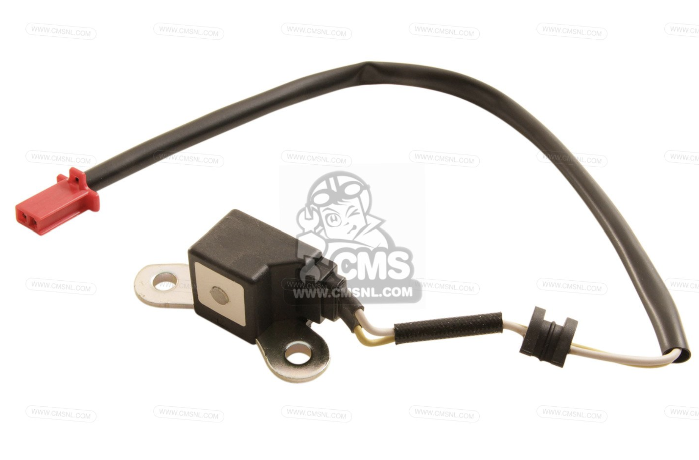

# Crank Position Sensor

*Figure 1: The crank position sensor*

>Part Number: 30300MEE003  
>Peak Voltage: 0.7 V minimum during starter-motor cranking  
>Connector: 2-pin

A crank position sensor is an electronic device used in an internal combustion engine to monitor the position or rotational speed of the crankshaft. This information is used by engine management systems to control the fuel injection or the ignition system timing and other engine parameters.

The crank sensor is used in combination with a similar cam position sensor (CMP) monitor the relationship between the pistons and valves in the engine. This method is also used to "synchronise" a four stroke engine upon starting, allowing the management system to know when to inject the fuel. It is also commonly used as the primary source for the measurement of engine speed in revolutions per minute.

The CKP used in the engine is a VR (Variable Reluctance) sensor positioned near the crankshaft that detects changes in the magnetic reluctance. This sensor detects the teeth of a rotating trigger wheel, changing the magnetic flux through the sensors coil and generating a voltage pulse, allowing the ECU to calculate the crankshaft angle and engine speed.