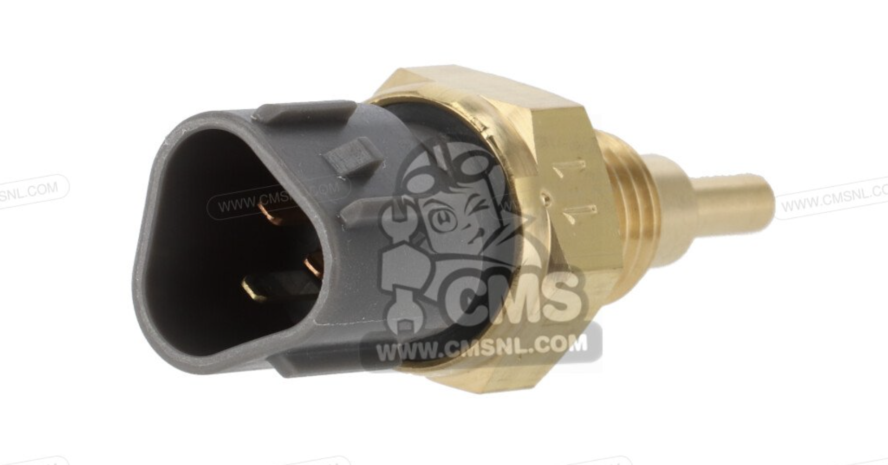

# Coolant Temperature Sensor

*Figure 1: The coolant temperature sensor.*

>Part Number: 37870MBG003  
>ECU sensing resitance at 20°C: 2.3-2.6kΩ  
>Connector: 3-pin

The coolant temperature sensor (CLT) measures the engine’s coolant temperature and sends a corresponding signal to the ECU. The ECU uses this information to adjust fuelling, particularly during cold starts, and can use it to control the radiator fan and monitor overheating.

This particular sensor used in the car is an NTC (Negative Temperature Coefficient) thermistor, which is a temperature sensitive resistor whose resistance decreases as the temperature increases.