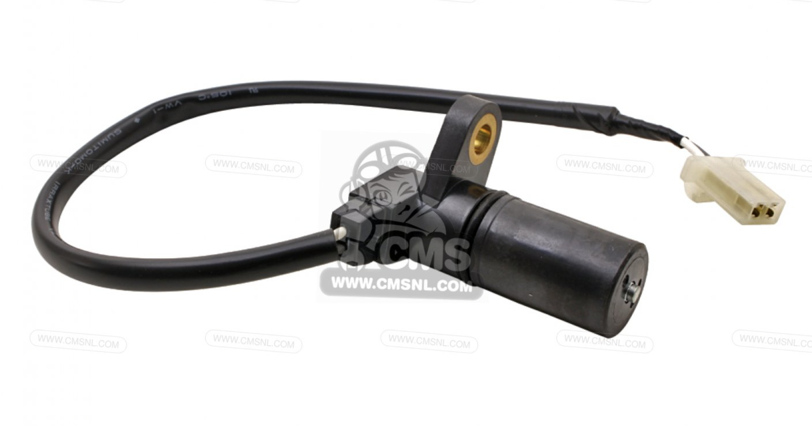

# Cam Position Sensor

*Figure 1: Not the exact version in the car but a later model of the same component*

>Part Number: 36140MEE000  
>Minimum peak voltage during cranking: 0.7V  
>Location: Cylinder Head  
>Connector: 2-pin

The camshaft position sensor (CMP) is an electronic device that tracks the rotational position and speed of the camshaft. This information is sent to the ECU, which uses it to determine the precise timing for fuel injection and ignition times, ensuring efficient engine operation, optimal power and reduced emmisions.

A cam position sensor is used alongside a crank position sensor as the camshaft rotates once for every two crankshaft revolutions in the engines full 720° four-stroke cycle.

The camshaft position sensor is a VR (Variable Reluctance) which is positioned near the camshaft that detects changes in the magnetic reluctance. This sensor detects the teeth on the camshaft as it rotates, changing the magnetic flux through the sensors coil and generating a voltage pulse, which allows the ECU to determine which stroke each cylinder is on.