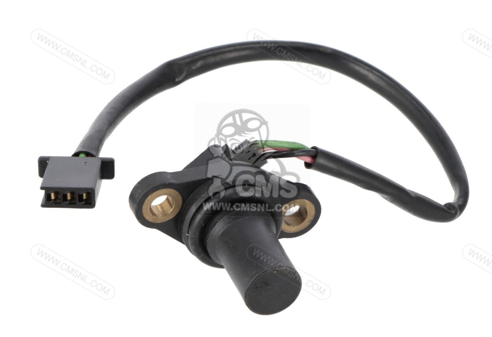

# Vehicle Speed Sensor

*Figure 1: The vehicle speed sensor.*

>Part Number: 37700MEE003  
>Power supply: 12V  
>Output: pulses switching between 0 and 5V  
>Connector: 3-pin
>Location: Upper Crankcase  

The vehicle speed sensor (VSS) detects rotation within the transmission and produces electrical pulses whose frequency increases with speed. These pulses allow the vehicle’s electronics to calculate road speed for the speedometer.

The VSS is a Hall-effect sensor which uses detects magnetic-field changes as gear teeth on the gearbox output shaft, which has a 4 teeth gear. The sensor produces digital pulses, with a higher pulse frequency indicating faster rotation. 